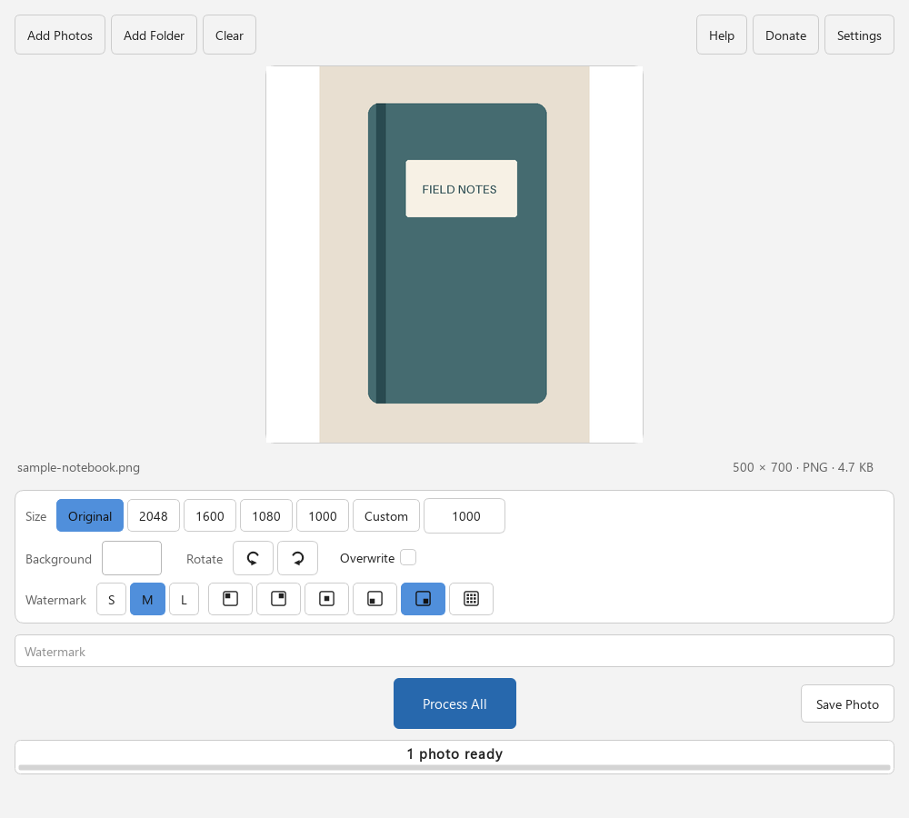

# Square Photo Padder

[](LICENSE)
[](https://github.com/steadystatestudio/square-photo-padder-releases/releases/latest)

**Make photos square — no cropping, no forced watermarks, no upload required.**

**[Website](https://steady-state-studio.steadystatestudio1.workers.dev/apps/square-photo-padder/)** · **[Download](https://github.com/steadystatestudio/square-photo-padder-releases/releases/latest)**

A free desktop app for Windows and Linux that fits complete photos inside a square.
Use it for square galleries, collages, catalogues and other workflows that accept
padded images. Add a batch, inspect the preview, and save JPEG copies beside your originals.
All features work offline; no account, uploads, subscription or telemetry.

**Check the destination before using padding or watermarks.** This app does not
certify marketplace compliance. [eBay disallows added borders, text and watermarks](https://www.ebay.com/help/policies/listing-policies/picture-policy?id=4370).
[Poshmark uses portrait cover photos](https://blog.poshmark.com/2026/03/25/your-guide-to-portrait-photos/).
Choose this tool when your destination calls for square images.

<p align="center">
  
</p>

## Why?

A square crop can cut off a tall subject or the edges of a wide photo. Padding preserves the whole photo and fills the unused area with your chosen background color.

## Features

- **Batch processing** — drag a folder of photos, process them all at once
- **Drag and drop** — drop files or folders anywhere on the window
- **Background colors** — black by default, or pick any custom color (remembered)
- **Watermark** — blended translucent text in any corner, center, or tiled across the image
- **Rotation** — 90° increments with live preview
- **Resize presets** — common square sizes (1000, 1080, 1600, 2048) or a custom size; images are never upscaled
- **Live preview** — see exactly what you'll get before processing
- **Resizable preview** — maximize the window for a larger centered square preview
- **Keyboard review** — Left/Right rotate, Up/Down browse, Enter saves the current photo
- **Photo details** — filename, dimensions, image format, and file size beneath the preview
- **No cloud** — everything runs locally, your photos never leave your computer
- **Cross-platform** — Windows and Linux (AppImage)

## Download

Choose the Windows ZIP or Linux AppImage from [GitHub Releases](https://github.com/steadystatestudio/square-photo-padder-releases/releases).

| Platform | Download |
|----------|----------|
| Windows  | `Square-Photo-Padder-windows.zip` — unzip and run |
| Linux    | `Square-Photo-Padder-x86_64.AppImage` — chmod +x and run |

No Python installation required. Qt/PySide source archives are included for developers and license compliance; you do not need them to run the app.

To update on Linux, close the app and replace the existing
`Square-Photo-Padder-x86_64.AppImage` with the new download in the same location.
The filename stays the same across releases, and saved settings are reused.
If you use an adjacent `.AppImage.home` or `.AppImage.config` folder for portable
settings, keep that folder and its matching filename when replacing the AppImage.
When updating from a version-numbered AppImage, rename its existing portable
settings folder once to `Square-Photo-Padder-x86_64.AppImage.home` or
`Square-Photo-Padder-x86_64.AppImage.config`, matching the suffix you already use.

> **Unsigned packages:** Windows may show a SmartScreen warning. Download only from
> the Studio release linked on the website and compare the published SHA-256 hash.
> Do not bypass a warning for an unexpected download or mismatched checksum.

## Quick Start

The toolbar keeps Add Photos, Add Folder and Clear together. Help, Donate and Settings stay at the right. Process All saves the batch; Save Photo saves only the displayed photo. The separate progress bar and status line remain visible after the job.

1. Download and run the app
2. Drag photos or folders onto the window, or click **Add Photos**
   Double-click a photo to add it immediately, or select photos and folders and click Open.
3. Adjust settings (resize, background color, watermark)
4. Click **Process All**
5. Find your squared photos next to the originals (`photo (1).jpg`)

To save one photo at a time, browse with **Up/Down**, rotate with **Left/Right**,
and press **Enter** or click **Save Photo**. Saving keeps you on the current photo;
**Process All** still saves the whole batch. Text and size fields keep their normal keyboard behavior.

By default originals are never modified — outputs get collision-safe names. Enable **Overwrite** to replace `photo.jpg` in place instead (this replaces the original for .jpg photos).

## Theme

Open **Settings** in the top-right toolbar to choose **System**, **Dark**, or **Light** appearance
and whether to show tooltips. Click **Save** to apply changes or **Cancel** to discard them.
System appearance automatically matches your OS theme.

The `SPP_THEME` environment variable overrides the appearance setting:

```bash
# Force dark theme
SPP_THEME=dark python -m photocropper

# Force light theme  
SPP_THEME=light python -m photocropper

# For AppImage
SPP_THEME=dark ./Square-Photo-Padder-x86_64.AppImage
```

## Development

Requires Python 3.11+.

```bash
# Setup
python -m venv .venv && source .venv/bin/activate  # Windows: .venv\Scripts\activate
pip install -e .[dev]

# Run
python -m photocropper

# Test
pytest                    # or xvfb-run pytest on headless Linux

# Lint
ruff check src/ tests/
```

## Support

Square Photo Padder is free and always will be. If it saves you time, you can [buy me a coffee on Ko-fi](https://ko-fi.com/steadystatestudio) — entirely optional, always appreciated.

## Building Releases

### Linux AppImage

```bash
pip install -c packaging/build-constraints.txt -e .[packaging]
./scripts/build_appimage.sh
```

### Windows Executable

```bash
pip install -c packaging/build-constraints.txt -e .[packaging]
python scripts/build.py
```

## License

[MIT](LICENSE)

### Safe saves

Images are fully encoded before an output replaces its source. With Overwrite on, only the source JPEG itself may be replaced; another photo with the same stem is kept and a numbered copy is saved instead. Repeating Process uses the photos already loaded in the preview, so generated copies are not silently added to the batch. Add the folder again to refresh its contents.

Before replacing a source, the app rechecks its file identity, size and timestamps.
Changes detected during processing stop that save and preserve the changed photo.
Avoid editing the same photo in another program while saving; these checks do not
lock out external writers.

### Testing packages

Build on the target OS with `python scripts/build.py`. Windows produces
`dist/Square-Photo-Padder-windows.zip`; Linux produces the stable AppImage and
`Square-Photo-Padder-linux-x86_64.tar.gz` for systems without FUSE. Extract the
tarball and run `square-photo-padder/square-photo-padder`.
`BUILD-INFO.json` records the source commit, tree and dependency versions;
`SHA256SUMS` identifies the exact unsigned testing packages. Linux packaging uses
checksum-verified appimagetool 1.9.1 and type2 runtime 20251108. The CI builds and smoke-tests packages after
the source tests; it does not publish a release.

Run `python scripts/smoke_bundle.py PATH_TO_EXECUTABLE` to check the packaged GUI,
JPEG output, source preservation and filename collisions in isolated storage.

## Image quality and privacy

Inputs: JPEG (`.jpg`, `.jpeg`), PNG and WebP. Outputs: high-quality JPEG (quality 95,
4:4:4), not lossless masters. Transparent pixels are blended onto your selected
background. The app applies EXIF orientation and converts valid embedded ICC
profiles to sRGB; invalid/unsupported profiles produce a per-file error instead of
silently changing color. Untagged photos are treated as sRGB. EXIF/GPS, author,
camera and other source metadata are not copied to exported JPEGs. Animated WebP
and PNG use their first frame; this is a still-photo tool.

Photos never upload, and there is no telemetry or automatic update request. The
optional Support button opens its existing external website in your browser.
Local settings remember appearance, watermark text and the last selected folder.

The source limit is 80 million pixels, 32,768 pixels on either side; square outputs
are capped at 8,192 pixels per side and a conservative 1.5 GiB working-memory
estimate. Watermarks increase this estimate. Choose a smaller output size for
large photos or panoramas. This is an allocation guard, not a guaranteed RAM usage.

During a batch, Process becomes **Cancel**. Cancel or closing the window lets the
current photo finish safely and stops before the next. Completed outputs remain;
remaining photos are not changed. A single photo decode/encode can still take time.
Keep backups before enabling Overwrite; it is not a recovery or undo system.

## Release verification

Manually dispatched draft staging runs tests on Windows and Ubuntu, builds native packages,
checks real frozen GUI/JPEG behavior, and retains exact checksums in a draft release.
It never publishes or changes repository visibility. Complete matching library
sources and license notices accompany public binaries. See `THIRD_PARTY_NOTICES.md`.

On Linux, the destination filesystem must support atomic no-replace renames.
Unsupported Windows-mounted, removable or network filesystems may refuse a save
rather than risk overwriting another file. Copy the photos to a normal local Linux
folder and retry; the failed save does not replace the originals.
